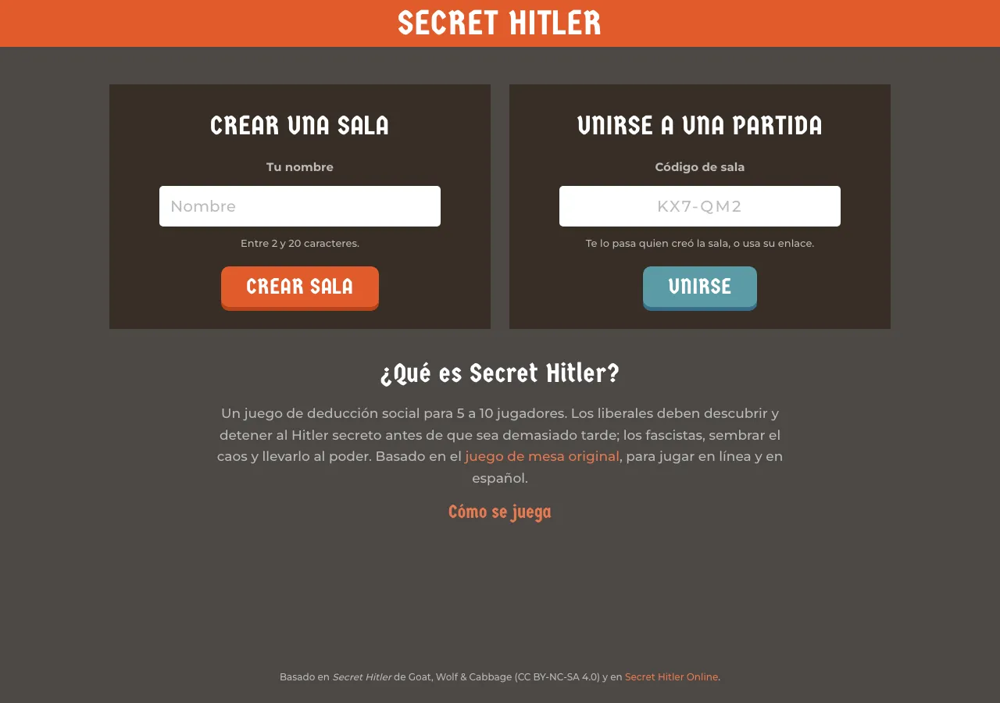
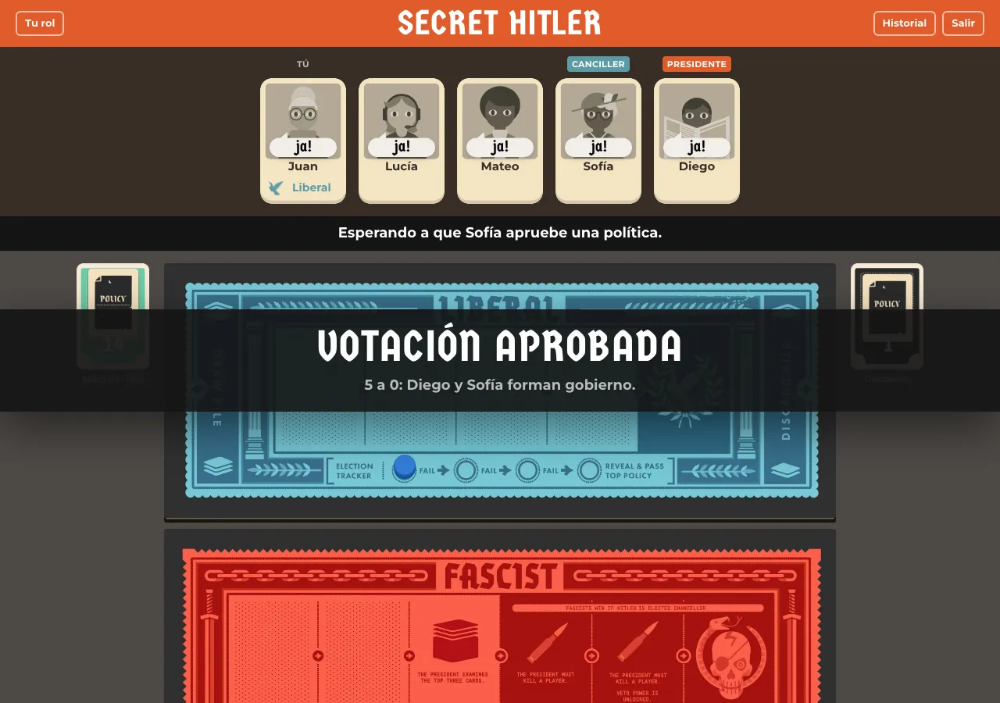
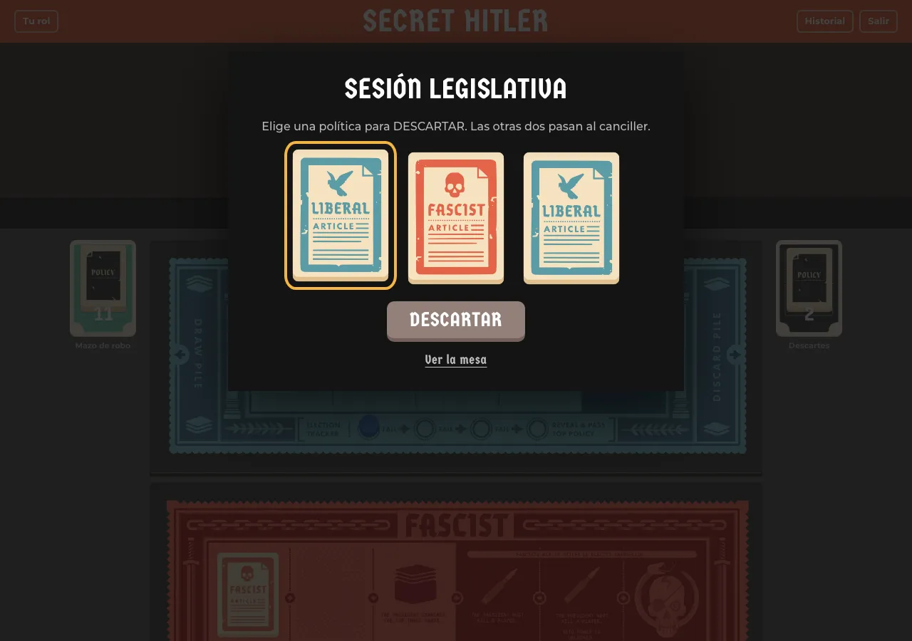
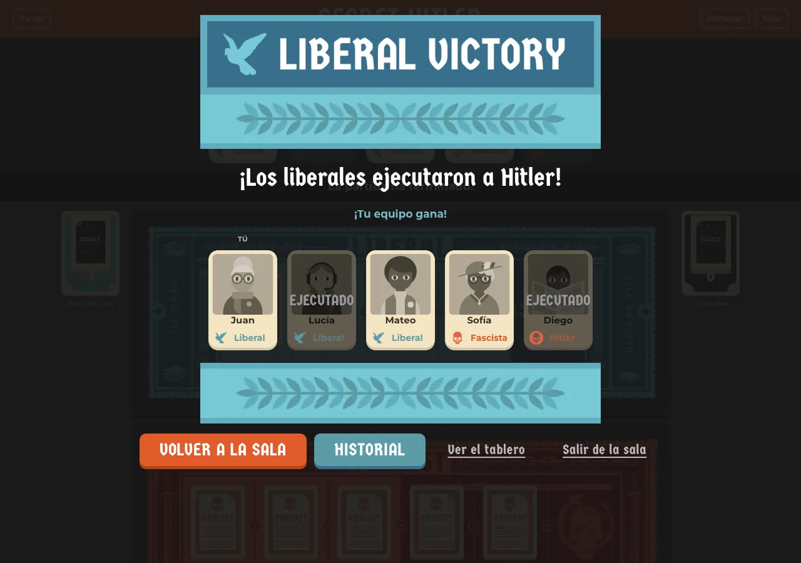

<div align="center">

# Secret Hitler

**Liberales contra fascistas, y un Hitler secreto entre ellos.**

Una adaptación web en español de [Secret Hitler](https://secrethitler.com), el juego de deducción social para 5 a 10 jugadores:<br>
creas una sala, compartes el enlace y empieza la legislatura.

### [▶ Jugar ahora: secrethitler.lat](https://secrethitler.lat)



</div>

---

## Cómo se juega

1. **Crea una sala** con tu nombre y comparte el enlace (o el código de 6 caracteres).
2. **Elige tu retrato** y marca que estás listo. Con 5 a 10 jugadores, el anfitrión empieza.
3. **Abre tu sobre.** Eres liberal, fascista o Hitler; los fascistas se conocen entre sí.
4. **Forma gobierno:** el presidente nomina canciller y todos votan ¡Ja! o Nein.
5. **Legisla:** el presidente descarta una política y el canciller aprueba otra. Algunas políticas fascistas dan poderes: investigar, espiar el mazo, elección especial o ejecutar.
6. **Gana tu bando:** cinco políticas liberales o Hitler ejecutado para los liberales; seis políticas fascistas o Hitler elegido canciller (con tres fascistas en la mesa) para los fascistas.

Las reglas completas están dentro del juego, en **Cómo se juega**.

<table>
  <tr>
    <td width="50%"></td>
    <td width="50%"></td>
  </tr>
  <tr>
    <td align="center"><sub>Los votos se revelan a la vez sobre cada jugador</sub></td>
    <td align="center"><sub>La sesión legislativa del presidente</sub></td>
  </tr>
  <tr>
    <td width="50%"></td>
    <td width="50%">
      <h3>Lo que trae</h3>
      <ul>
        <li>Los tres tableros (5–6, 7–8 y 9–10 jugadores) con todos sus poderes y el veto</li>
        <li>Cada jugador solo recibe lo que puede saber: ni cartas ajenas ni votos antes de tiempo</li>
        <li>Historial de gobiernos, votos y políticas</li>
        <li>Si alguien pierde la conexión, la partida se pausa y su asiento le espera</li>
        <li>Recargar la página no te saca de la mesa</li>
        <li>Funciona en escritorio y en el móvil, todo en español</li>
      </ul>
    </td>
  </tr>
  <tr>
    <td align="center"><sub>Al final se revelan todos los roles</sub></td>
    <td></td>
  </tr>
</table>

---

## Desarrollo

Necesitas **Node 22+** y **pnpm 9**.

```sh
pnpm install
pnpm dev
```

`pnpm dev` levanta dos cosas:
- el Worker de Cloudflare con las salas, en `http://localhost:8787`;
- la web, en `http://127.0.0.1:5173`, que reenvía `/api` al Worker.

Para sentar a varios jugadores, abre varias ventanas (o una normal y otra privada), o llena la mesa con bots:

```sh
pnpm --filter @sh/e2e fill <CÓDIGO> [bots=4] [ms entre jugadas=1500]
```

### Comprobaciones

| Comando | Qué hace |
|---|---|
| `pnpm lint` | Biome: formato y lint |
| `pnpm typecheck` | TypeScript en todos los paquetes |
| `pnpm test` | Pruebas unitarias: motor (incluidas 1.800 partidas aleatorias), protocolo, salas y web |
| `pnpm build` | Compila la web en `apps/web/dist` |
| `pnpm e2e` | Partidas completas de 5 y 7 jugadores en Chromium contra bots, con una recarga a mitad (arranca `pnpm dev` si no está en marcha) |
| `pnpm --filter @sh/server smoke` | Partida completa por WebSocket contra el Worker local, con desconexión y reconexión |

Para ver cada pantalla: `SHOTS=<carpeta> VIEWPORT=390x844 node e2e/tour.ts 7` juega una partida y guarda una captura de cada pantalla nueva.

### Despliegue

```sh
pnpm build
pnpm --filter @sh/server run deploy
```

Publica en Cloudflare el Worker con las salas y la web compilada, en `secrethitler.lat`. Antes hay que iniciar sesión con `npx wrangler login`.

---

## Cómo está hecho

| Capa | Tecnología |
|---|---|
| Motor de reglas | TypeScript puro, sin dependencias; estado inmutable y vistas por jugador que solo muestran lo que cada uno puede saber |
| Servidor | Cloudflare Workers con un Durable Object por sala y WebSockets con hibernación |
| Protocolo | Mensajes tipados y validados con Zod en el servidor |
| Web | React 19, Vite, Tailwind CSS 4, Zustand, Motion y React Router |
| Pruebas | Vitest, Testing Library y Playwright con bots |

```
config/            reglas del juego (fuente de verdad)
packages/engine    motor de reglas
packages/protocol  mensajes cliente ↔ servidor y sus esquemas
apps/server        Worker + Durable Object por sala
apps/web           interfaz React
e2e                pruebas de extremo a extremo y bots
docs               arquitectura (stack.md) y capturas
```

Más detalle en [`docs/stack.md`](docs/stack.md) y las reglas en [`config/secret-hitler-rules.json`](config/secret-hitler-rules.json).

---

## Licencia y créditos

Este proyecto está licenciado bajo [Creative Commons BY-NC-SA 4.0](https://creativecommons.org/licenses/by-nc-sa/4.0/).

Basado en:
- Juego de mesa original: [Secret Hitler](https://secrethitler.com) por Goat, Wolf & Cabbage (© 2016-2020), cuyas ilustraciones se adaptan aquí.
- Implementación web: [Secret Hitler Online](https://github.com/ShrimpCryptid/Secret-Hitler-Online) por ShrimpCryptid (© 2020-2023), de donde vienen los retratos y la estética.

Este proyecto no está afiliado ni respaldado por Goat, Wolf & Cabbage.
